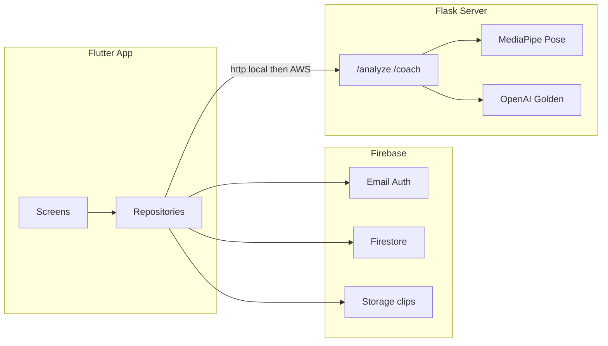

# RallyLoop Phased Build Plan

Starting point: blank Flutter counter in [`app/lib/main.dart`](app/lib/main.dart). Target platforms: iOS/Android primary, web for UI testing. Backend: local Flask + MediaPipe first, AWS later. Auth: Firebase email/password. Coach: scripted in Alpha/Beta, OpenAI in Golden.

## Todos

- [ ] Theme, shell nav, shared widgets, mock models/data
- [ ] Build Home/Dashboard page from mockup
- [ ] Build Train choose / record / side-by-side pages
- [ ] Build Session Recap and Coach Chat (scripted)
- [ ] Build Community, Challenges, and Me stub pages
- [ ] Firebase setup, email/password auth, user docs
- [ ] Local Flask /analyze with MediaPipe + AnalysisApi
- [ ] Real recording, Storage upload, Firestore sessions/swings
- [ ] Live community feed, AI reply summaries, question leaderboard, challenges
- [ ] OpenAI /coach endpoint, polish, AWS deploy + live URL

## Architecture

**Repo layout (new):**
- [`app/lib/`](app/lib/) — Flutter app (`theme/`, `models/`, `data/`, `widgets/`, `screens/`, `services/`)
- `server/` — Flask + MediaPipe (created in Beta)

**Defaults locked in:** Provider for state, email/password Auth, mock Coach until Golden OpenAI, analysis server URL via `--dart-define=API_BASE_URL=http://localhost:5000`.

---

## Phase 1 — Alpha (UI + mock data)

Goal: navigable dark-theme demo that matches the mockups. No Firebase, camera, or Flask yet.

### 1.1 Foundation
- Rename app to RallyLoop in [`app/pubspec.yaml`](app/pubspec.yaml); add `provider`, `google_fonts`, `fl_chart` (recap graph), `percent_indicator` (score rings).
- Theme tokens from mockups: bg `#0D1117`, card `#1F2937`, accent `#C6FF00`, danger/warning reds/yellows; dark `ThemeData` + shared widgets (`AppCard`, `NeonButton`, `PillBadge`, `ScoreRing`, `ProgressBar`).
- Replace counter with `MainShell` + 5-tab bottom nav: Home, Train, Coach, Community, Me.
- Seed `MockData` models: user “Maya”, technique scores, strokes, swings, session recap, coach messages, community posts, challenges/leaderboard.

### 1.2 Pages (one small step each)
Build screens against mock data in this order so each PR/step is reviewable on web:

1. **Home / Dashboard** — greeting + streak, technique score ring + FH/BH/Serve/Return, “Pick up where you left off”, weekly challenge card, “Start a training session”, recent swings row.
2. **Train Step 1 — Choose stroke** — 2×2 stroke grid, reference clip placeholder + phase chips (Ready → Follow-through), “Record my attempt”.
3. **Train Step 2 — Record** — camera-frame placeholder, skeleton overlay mock, timer, keypoint banner, record/speed/flip controls (non-functional).
4. **Train Step 3 — Side-by-side** — REF vs YOU panels, phase scrubber, joint metrics list, largest-deviation card, Next swing / Ask Coach.
5. **Session Recap** — swings/avg/best stats, Priority 1 fix card + drill, match-score line chart, Share / Ask Coach.
6. **Coach Chat** — stroke chip, scripted bubbles grounded in mock session, suggestion chips, send appends canned replies.
7. **Community feed** — filters, post card (video placeholder + AI summary), Give feedback.
8. **Challenges** — active challenge + progress, team leaderboard (You highlighted), milestone badges.
9. **Me (profile stub)** — name, grade/score, streak, question-ask points placeholder, sign-out placeholder.

Wire flows: Home CTA → Train wizard → Recap → Ask Coach; Community ↔ Challenges via header/tab.

**Alpha exit:** full UI on web/device with mock data only.

---

## Phase 2 — Beta (auth, Firestore, real capture + pose)

Goal: real accounts, persisted sessions, record a swing, get analysis from local Flask/MediaPipe.

### 2.1 Firebase
- Add `firebase_core`, `firebase_auth`, `cloud_firestore`, `firebase_storage`; configure iOS/Android/web.
- Auth screens: login + register (email/password); gate `MainShell` behind auth; create `users/{uid}` on signup.
- Firestore collections (minimal):
  - `users` — profile, streak, questionPoints
  - `sessions` — swings[], avgMatch, best, priorityFix
  - `swings` — stroke, match%, keypoints summary, metrics, videoUrl
  - `challenges` / `challengeProgress` — seed one weekly challenge

### 2.2 Local analysis server
- Create `server/` with Flask: `POST /analyze` accepts video + stroke type; MediaPipe Pose on frames; compare to bundled reference keypoints; return match %, joint deltas, largest deviation, overlay keypoints JSON.
- `GET /health`; CORS for Flutter web; `requirements.txt` + short run README.
- Flutter `AnalysisApi` pointing at `API_BASE_URL` (localhost for now).

### 2.3 Capture + Train flow (real)
- `camera` + `video_player` (mobile); web keeps file-picker/mock path for testing.
- Record attempt → upload to Storage → call `/analyze` → show Side-by-side with real metrics → write swing/session to Firestore.
- Home/Recap read live user data when present; fall back to empty states.

### 2.4 Coach (still scripted)
- Persist chat threads in Firestore; replies stay rule-based from latest session metrics (no OpenAI yet).

**Beta exit:** sign up/in, record (mobile), analyze via local Flask, see results + recap from Firestore.

---

## Phase 3 — Golden (full product)

Goal: all mockup features live; deploy server; OpenAI Coach.

### 3.1 Community + questions leaderboard
- Post clip to feed; teammate replies; server/app produces AI summary of replies.
- Asking Coach/community questions increments `questionPoints`; Community/Me leaderboard for most questions asked.

### 3.2 Weekly Challenges
- Track challenge progress from real swing/serve metrics; live leaderboard; unlock milestone badges.

### 3.3 OpenAI Coach
- Flask `POST /coach` with session/swing context + user message; stream or return grounded answer; Flutter switches Coach from scripted → API.
- Keep scripted fallback if key missing.

### 3.4 Polish + deploy
- Slow-mo overlays, scrub sync polish, empty/error states, permissions copy.
- Deploy Flask to AWS (EC2/ECS); switch app to live `API_BASE_URL`; security rules for Auth/Firestore/Storage.

**Golden exit:** end-to-end RallyLoop matching mockups with live analysis, community, challenges, and OpenAI Coach.

---

## Implementation order (small iterative chunks)

Work Alpha 1.1 → each page in 1.2 → Beta Firebase → Flask → capture → Golden features. Prefer web for UI; use iOS/Android when camera is required. Do not deploy AWS until Golden 3.4.
